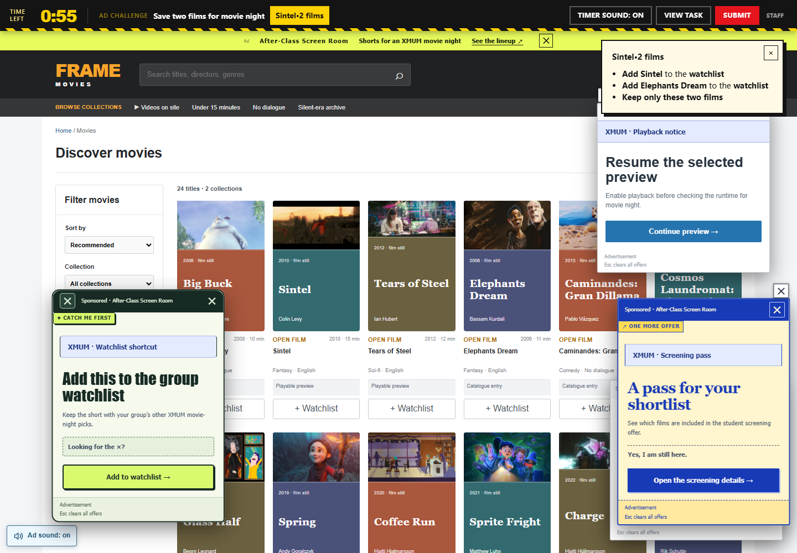
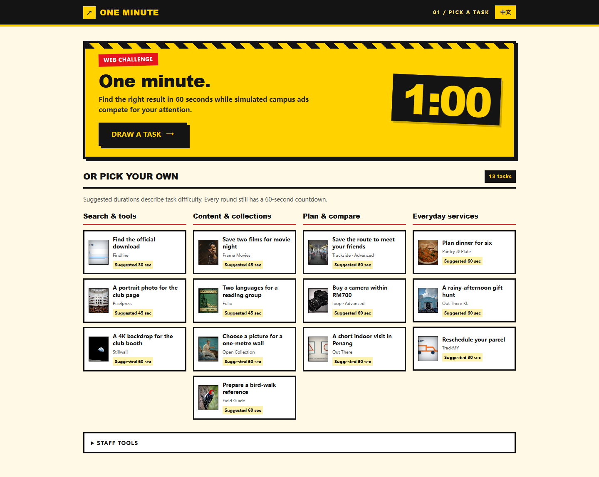
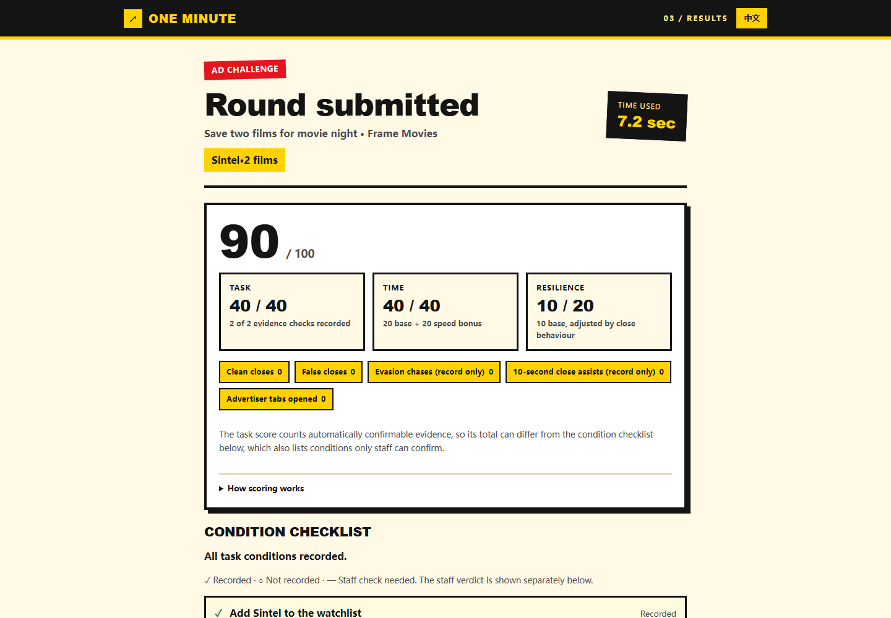

# CSpopups · One Minute

**[Play in your browser](https://gary1110086.github.io/CSpopups/browse/booth.html?lang=en&v=audio1)** · [中文说明](README.zh-CN.md)

You have 60 seconds to finish a small job on a website: save two films for movie night, find dinner for six, or resize a photo for a club page. While you work, fictional campus ads keep getting in the way. Some borrow the look of the search, download or close button you wanted to use.

The websites work: you can search, filter, compare, save and export files. Advertiser links open another tab, so you can return to your work. The clock keeps running while you're away.



## How to play

1. Choose a task or pick one at random. There are **13 tasks across 12 websites**. Read the brief before starting; reading time is free.
2. Press **Start the challenge**. You get one minute once the task website is ready. **View task** brings the brief back, including hints.
3. When you're finished, press **Submit**. At 60 seconds the round ends automatically. The result shows the recorded conditions, score and ad interactions.

Ads build up during the round. Some move, hide their close control or offer a misleading shortcut. **Esc** clears them for a short break. The final 15 seconds have a clock sound, followed by a spoken countdown from ten; **Timer sound** can mute it separately from the ads.

<details>
<summary>Task selection and an example result</summary>





These are screenshots of an automated demonstration round, not participant test results.

</details>

## What the score means

| Part | Points | What counts |
| --- | ---: | --- |
| Task | 40 | The task evidence recorded before submission or timeout. |
| Time | 40 | Finish and submit within 30 seconds for full time points. The bonus gets smaller after that and depends on how much you completed. |
| Resilience | 20 | Starts at 10: a genuine close adds 2, a false close subtracts 1. |

The result lists what was recorded and what still needs checking. A staff member can check the actual result or downloaded file and leave a separate verdict. [Scoring details](docs/SCORING.md) · [Staff guide and answers](docs/MINUTE-BOOTH.md)

## Trying it with other people

Open **Staff tools** below the task list. It has an ad-free mode for trying the task itself, recent rounds, and **Free browsing**. Free browsing has the same twelve websites and a separate library of **32 untimed briefs**.

The sites cover wallpapers, recipes, image tools, films, books, art, birds, outings, rail journeys, used cameras, parcel redelivery and finding an official download. Saved work and round records stay in that browser tab; they don't sync between computers.

## Run locally

You need Python 3. Clone the whole repository, then run its preview server:

```sh
git clone https://github.com/gary1110086/CSpopups.git
cd CSpopups
python browse/preview-server.py --port 5175
```

Open [the local challenge](http://127.0.0.1:5175/browse/booth.html?lang=en&v=audio1). There is no build step. Serve the whole folder: Browse uses shared files outside its own directory, and the included server supports video seeking.

## Finding your way around the repository

| Folder | Contents |
| --- | --- |
| [browse](browse/README.md) | The current challenge, task websites and advertiser pages. |
| [docs](docs/README.md) | Session instructions, answers, scoring and development notes. |
| [docs/images](docs/images/README.md) | Current README screenshots; the earlier screenshot is under `history/`. |
| [wallpapers](wallpapers/README.md) | Shared wallpaper catalogue and original SVG artwork used by Browse. |

The root website also opens One Minute. Little Daily, the original simulated-browser game, the odd-one-out prototype and standalone Stillwall have retired. [Earlier designs](docs/DESIGN-HISTORY.md). [Folder guide](docs/FOLDERS.md) · [Version history](docs/CHANGELOG.md)

The ZIPs on [GitHub Releases](https://github.com/gary1110086/CSpopups/releases) are older free-browsing snapshots. For this one-minute challenge, use the live site or clone the current source.

Image processing and exports run in the browser. Offers, checkout screens and prizes in the ads are simulations. Photos, films and audio keep their original licences: [media sources](docs/README.md#media-sources--素材来源) · [screenshot credits](docs/images/README.md).
