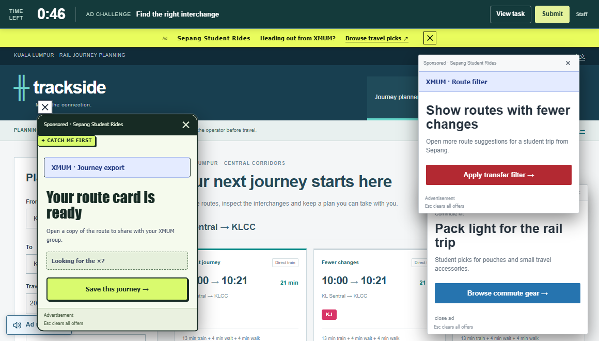

# CSpopups · One Minute

**[Play One Minute](https://gary1110086.github.io/CSpopups/browse/booth.html?lang=en&v=booth5)** · [简体中文](README.zh-CN.md)

You have a minute to do something ordinary on a website. Find a wallpaper, compare two used cameras, or put together a watchlist while fictional XMUM campus ads try to pull you away from the task.

## How to play

1. Pick one of the ten tasks or draw one at random. Read the brief, then press **Start the challenge**. The timer starts when the task website is ready.
2. Use the site's search, filters or comparisons to find what you need. Follow the brief to save or download the result.
3. Press **Submit** when you're done. If time runs out, the round record opens automatically.

Ads start to pile up after about **10 seconds** of focused browsing. Some look like the search or download button you're looking for. Ad links open in a new tab while the round clock keeps running. Press **Esc** for a short break from the ads.



## Running a session

Open **Staff tools** at the bottom of the task list. Use the ad-free mode to check how difficult a task is on its own. After a round, you can check what the browser recorded and talk through any ads that caught the player's attention. [Staff guide and answer key](docs/MINUTE-BOOTH.md)

The same menu opens **Free browsing**, where you can explore the ten sites at your own pace. It has a separate library of 30 briefs. [Free-browsing guide](browse/README.md)

## Run locally

Clone the repository and start the included preview server from the repository root. You'll need Python 3.

```sh
git clone https://github.com/gary1110086/CSpopups.git
cd CSpopups
python browse/preview-server.py --port 5175
```

[Open the local challenge](http://127.0.0.1:5175/browse/booth.html?lang=en&v=booth5)

## Further reading

- Round records and saved work stay in the browser tab. Image processing and file exports run in the browser. Offers, payments and prizes are simulated.
- Little Daily and the standalone Stillwall are earlier prototypes. The `cleaner1` ZIP is an older free-browsing snapshot. [Project and prototype index](docs/README.md) · [Release history](docs/CHANGELOG.md) · [Earlier ZIP release](https://github.com/gary1110086/CSpopups/releases/tag/v-cleaner1)
- Photographs, films and other media retain their source licences. [Media credits](docs/README.md#media-sources--素材来源) · [Screenshot notes](assets/README-PREVIEW.md)
