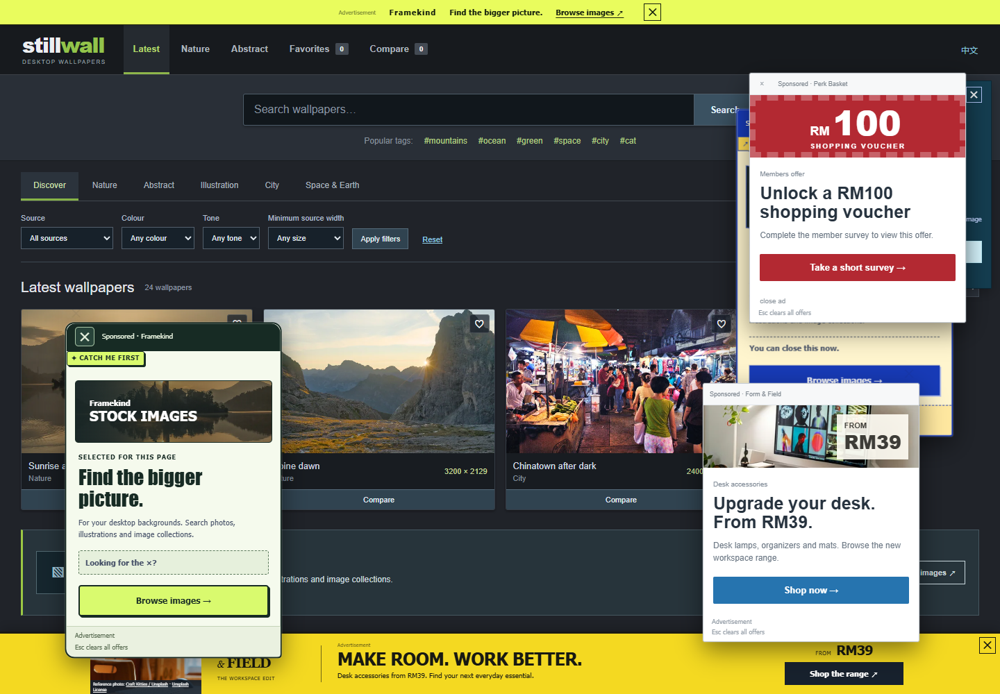

# CSpopups

一个围绕注意力、广告与误导设计的浏览体验。参与者完成普通的网页任务，同时处理不断出现的正常推广和误导弹窗。

**[立即试玩 →](https://gary1110086.github.io/CSpopups/browse/launch.html?lang=zh&v=reflect1)** · [English](README.md)

当前版本：**[reflect1](https://github.com/gary1110086/CSpopups/releases/tag/v-reflect1)** · [下载本地运行包](https://github.com/gary1110086/CSpopups/releases/download/v-reflect1/Browse-scenarios-reflect1.zip) · [查看更新记录](docs/CHANGELOG.md)



*Stillwall 的实际运行截图，它是十个任务网站之一。[照片署名与来源](assets/README-PREVIEW.md)。*

## 怎么玩

1. **领取任务。** 找一张壁纸、安排一次出游、比较相机，或选择其他日常目标。
2. **浏览并作出选择。** 搜索、筛选、阅读详情、对比、收藏，或者导出结果。
3. **处理干扰。** 关闭广告，或进入真实的广告标签页，再返回原来的任务。
4. **回顾体验。** 讨论什么吸引了注意、哪些控件具有误导性，以及如何恢复原来的工作。

当前的 **Browse** 版本包含 **10 个任务网站、30 项任务和 10 个广告目的地**，使用浏览器本身的地址栏、标签页、历史记录和刷新功能。

| 入口 | 用途 |
| --- | --- |
| [选择网站](https://gary1110086.github.io/CSpopups/browse/launch.html?lang=zh&v=reflect1) | 自由探索十个场景。 |
| [随机分配任务](https://gary1110086.github.io/CSpopups/browse/?task=random&lang=zh&v=reflect1) | 随机进入一个任务及对应网站。 |
| [任务库](https://gary1110086.github.io/CSpopups/browse/tasks.html?lang=zh&v=reflect1) | 开始前阅读任务要求和预期结果。 |
| [主持人答案](https://gary1110086.github.io/CSpopups/browse/tasks.html?mode=host&lang=zh&v=reflect1) | 工作人员可在另一台设备核对参与者的结果。 |
| [参考网页与骗局案例](https://gary1110086.github.io/CSpopups/browse/guide.html?lang=zh&v=reflect1) | 查看设计对标和已有案例。 |

任务要求放在独立任务库中；浏览页面顶部的任务／笔记面板目前隐藏。体验没有可见的游戏计时器、自动评分或自动结束。

## 十个日常网站

| 网站 | 可以完成的操作 |
| --- | --- |
| **Stillwall** · 壁纸 | 找照片、核对来源、比较图片，并下载 JPEG。 |
| **Pantry & Plate** · 食谱 | 按食材和饮食要求筛选、调整份量，并导出食谱。 |
| **Pixelpress** · 图片工具 | 在本地缩放或压缩图片，对比效果，并保存处理结果。 |
| **Frame Movies** · 电影 | 查找真实开放电影和默片经典，建立片单，并播放部分预览。 |
| **Out There KL** · 出游 | 比较周末指南、核对雨天方案，并导出计划或日历文件。 |
| **Folio** · 书籍 | 查看历史版本、阅读节选，并保存书目或摘录。 |
| **Open Collection** · 博物馆 | 查看真实藏品、比较作品，并策划一组小展览。 |
| **Field Guide** · 鸟类 | 根据照片、外观特征、栖息地及可用叫声，比较北美鸟类。 |
| **Trackside** · 轨道出行 | 规划吉隆坡轨道行程、核对换乘，并保存路线。 |
| **loop** · 二手相机 | 比较虚构相机商品、检查配件，并准备保存在本地的询问草稿。 |

## 广告与弹窗

广告分布在检索结果、阅读路径、横幅和叠加浮窗中。文案会结合当前场景与搜索内容，同一赞助商也会跟随页面访问继续出现。

- **移动与闪避：** 屏幕内反弹、随机闪避四至六次，以及部分会话中的碰撞推挤。
- **误导控件：** 小型或透明关闭按钮、不同位置的关闭按钮，以及外形像关闭按钮的广告链接。
- **退出机制：** 仅有隐蔽关闭按钮的弹窗在前台专注浏览十秒后，显示明显的真关闭，并停止移动。
- **广告内也能操作：** 目的地包含商店、图片下载、可玩小游戏、转盘和优惠比较，以及有明确终点的骗局教学流程。

**按 Esc 可以暂时清除广告。** 键盘聚焦会暂停移动，触屏不会触发闪避。广告节奏只在场景处于前台且获得焦点时推进。

广告标签页保留原来的任务页面。Browse 中真正的下载、收藏和普通网页导航可以正常使用。

## 页面变化、Cookie 选择与复盘

- 部分网站会延迟加载一块赞助广告，真实挤开列表或正文；每个网站、每次会话只出现一次，真正关闭后会记住。
- Cookie 横幅突出“接受全部”，“管理偏好”中有分类开关、保存和真正的拒绝入口。必要存储固定开启，可选项默认关闭；选择只在当前会话中保存，不会启用追踪。
- 工作人员可从网站选择页主动打开[浏览复盘](https://gary1110086.github.io/CSpopups/browse/review.html?lang=zh&v=reflect1)，查看广告打开结果、假关闭按钮点击、实际闪避次数、事件时间线和讨论提示，也可以导出 TXT。

复盘不会自动结束浏览或判断任务答案对错。记录保存在参与者当前浏览器标签页，不包含搜索文字、草稿或图片内容；可以单独清除，不影响收藏与处理结果。另一台电脑无法读取这份本地记录。

## 随机事件

每次体验从八种事件中选取三种适合当前网站的事件，由浏览操作触发，让同一个任务也能有不同经历：

- 赞助客服先正常搭话，逐渐推荐到其他优惠。
- 进入广告标签时，原标签标题出现消息提醒；返回后显示赞助消息。
- 静音影片横幅滚出视野后，缩成跟随式小播放器。
- 搜索联想同时提供真实检索快捷项和单独标注的赞助链接。
- 拒绝广告后，优惠从九折升级到八折，再到神秘礼盒。
- 小型动画角色带来与场景有关的推广。
- 短暂清静之后，赞助商带着回归消息再次出现。
- 真正完成收藏或导出后，可能收到可选的额外奖励推广。

## 本地运行

项目由静态 HTML、CSS 和 JavaScript 组成。使用 Python 3 启动内置预览服务器，它支持视频拖动定位。

```sh
git clone https://github.com/gary1110086/CSpopups.git
cd CSpopups
python browse/preview-server.py --port 5175
```

打开[本地网站选择器](http://127.0.0.1:5175/browse/launch.html?lang=zh&v=reflect1)。

需要从仓库根目录提供文件：Browse 还使用 `assets/` 和 `wallpapers/` 中的共享资源。`127.0.0.1` 是本机地址；给其他电脑分享时，请使用上面的公开试玩链接。

使用[本地运行包](https://github.com/gary1110086/CSpopups/releases/download/v-reflect1/Browse-scenarios-reflect1.zip)时，请完整解压 ZIP，并按 `START-HERE.txt` 操作。包内包含媒体、共用依赖和源文件哈希清单。

公开演示托管在 GitHub Pages，也可以保持仓库目录结构，在其他静态网站服务上部署。

## 仓库目录

```text
browse/                     当前任务网站与广告体验
docs/                       文档索引与版本记录
prototypes/little-daily/    早期文章站的脚本和样式
wallpapers/                 独立 Stillwall，以及共用的壁纸资源
assets/                     共用图片、图标与 README 预览图
*.html                      保留的网页入口及 404 页面
```

[文档索引](docs/README.md) · [Browse 详细说明](browse/README.md) · [设计说明](browse/DESIGN-NOTES.md) · [验证记录](browse/VERIFICATION.md)

根目录的 [Little Daily 入口](https://gary1110086.github.io/CSpopups/)与[独立 Stillwall](https://gary1110086.github.io/CSpopups/wallpapers/?lang=zh&v=wallpaper1)保留各自的行为和会话状态。原 HTML 网址继续保留，Little Daily 的脚本与样式集中在 `prototypes/little-daily/`。**当前体验请从 `browse/launch.html` 开始。**

## 素材与隐私

体验同时包含正常广告与误导案例，广告本身不等于诈骗。练习中的网站与广告商身份及模拟交易均为虚构；软件安装、设备扫描、付款、奖品和包裹领取属于教学演示。壁纸、图片、文本和日历导出会生成真实的本地下载文件。

项目没有玩家账号、广告 SDK 或远程应用分析服务。本地操作记录用于工作人员主动打开的复盘，有数量上限。图片在浏览器内处理，偏好与收藏等使用当前标签的会话存储。**分享链接不会在不同电脑之间同步进度。** 托管平台仍会接收正常的网站访问请求。

真实照片、历史图片、插图、音频和影片分别保留原来源的许可；部分早期生成素材为兼容而保留。署名、修改和来源记录见：

- [风景、食谱、地点、电影与工作空间照片](browse/assets/REAL-MEDIA-SOURCES.md)
- [可播放影片](browse/assets/VIDEO-SOURCES.md)及[电影剧照](browse/assets/OPEN-FILM-STILLS.md)
- [NASA 照片](browse/assets/NASA-SOURCES.md)
- [书籍与博物馆藏品](browse/culture-SOURCES.md)
- [鸟类、声音与轨道交通参考](browse/journey-SOURCES.md)
- [相机照片](browse/assets/MARKET-SOURCES.md)及[早期生成素材](browse/assets/ASSET-SOURCES.md)

被引用的创作者、机构和服务并未为本项目背书。轨道时间、商业优惠和相机商品包含演示数据。
