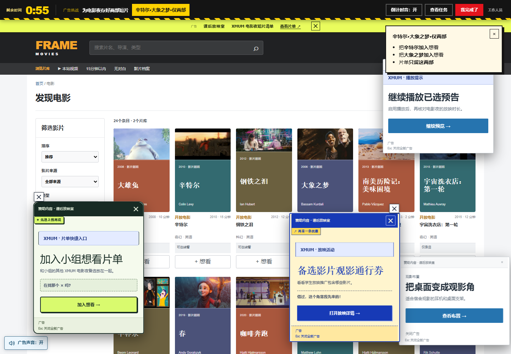
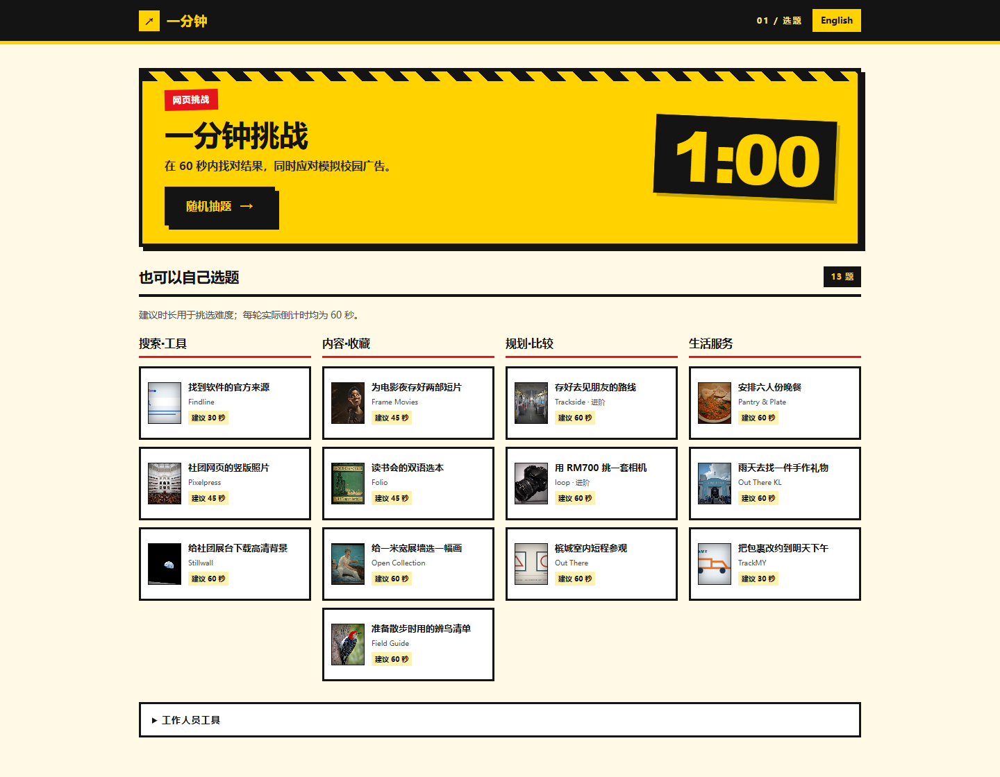
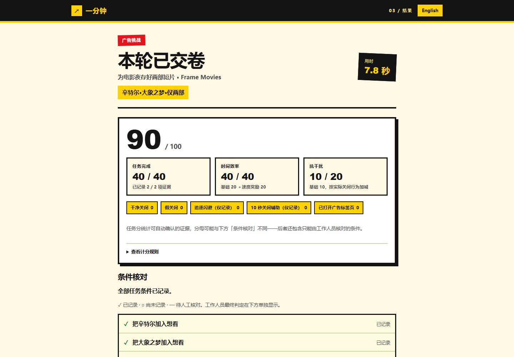

# CSpopups · 一分钟挑战

**[打开挑战](https://gary1110086.github.io/CSpopups/browse/booth.html?lang=zh&v=audio1)** · [English](README.md)

这是一场在浏览器里玩的限时小挑战。要做的事都不复杂：给电影夜存两部短片，安排六个人的晚餐，或者把社团网页要用的照片压到指定大小。麻烦的是，广告会在你操作的时候不断挤进来，有些按钮还故意长得像你要找的入口。

网页里的搜索、筛选、对比、收藏和文件导出都能实际操作。点到广告会另开标签页，回来还能接着做，但那一分钟不会等你。



## 怎么玩

1. 自己选题，也可以随机抽。现在有 **13 道题、12 个网站**。先看清题目和完成条件，读题时不计时。
2. 点「开始挑战」，网页就绪后开始倒计时。忘了要找什么，可以点顶部的「查看任务」，里面也有提示。
3. 做完点「我完成了」，提前交卷；满 60 秒会自动结束。结果页会列出这轮记录到的条件、分数和广告互动。

广告会越积越多，有些会移动、把关闭按钮藏起来，或给你一个看起来很方便的捷径。按 **Esc** 可以暂时清掉它们。最后 15 秒会响起钟声，剩 10 秒时加入语音倒数；顶部的「倒计时音」可以单独关掉。

<details>
<summary>看看选题页和结果页</summary>





图中是自动操作的演示轮次，用来展示页面，不是玩家实测成绩。

</details>

## 分数怎么算

| 项目 | 满分 | 大致规则 |
| --- | ---: | --- |
| 任务完成 | 40 | 看截止前实际记录到多少任务证据。 |
| 时间效率 | 40 | 全部完成、30 秒内交卷得时间满分；之后奖励逐渐降低，完成进度也会影响奖励。 |
| 抗干扰 | 20 | 从 10 分起算，真正关闭一次 +2，点到假关闭 −1。 |

结果页会把「已记录」「尚未记录」「待人工核对」分开显示。工作人员可以再看实际结果和下载文件，留下单独的判定。具体怎么算、哪些情况不能自动确认，见[计分规则](docs/SCORING.md)和[现场说明](docs/MINUTE-BOOTH.md)。

## 带同学试玩

选题页最下面有「工作人员工具」。可以先开无广告模式试题目，看看同学是卡在题目本身，还是被广告带走了。这里也能查看最近轮次、打开「自由浏览」。

自由浏览可以慢慢逛这十二个网站，另有 **32 道不限时任务**。内容包括壁纸、食谱、图片处理、电影、书、画作、鸟类、出游、轨道交通、二手相机、快递改约和寻找官方下载来源。

收藏和轮次记录留在当前浏览器标签页，不会跨电脑同步。现场的交接、答案和记录导出，放在[工作人员说明](docs/MINUTE-BOOTH.md)里。

## 本地运行

装好 Python 3，克隆整个仓库后运行：

```sh
git clone https://github.com/gary1110086/CSpopups.git
cd CSpopups
python browse/preview-server.py --port 5175
```

然后[打开本地挑战](http://127.0.0.1:5175/browse/booth.html?lang=zh&v=audio1)。不用构建。请保留完整目录，部分素材由几个原型共用；内置服务器也支持视频拖动播放。

## 文件放在哪里

| 目录 | 内容 |
| --- | --- |
| [browse](browse/README.md) | 当前挑战、任务网站和广告页面。 |
| [docs](docs/README.md) | 玩法、答案、计分与开发说明。 |
| [docs/images](docs/images/README.md) | 现在的 README 截图，早期截图放在里面的 `history/`。 |
| [prototypes/little-daily](prototypes/little-daily/README.md) | 早期文章站的运行代码，根目录的旧网址仍保留。 |
| [wallpapers](wallpapers/README.md) | 独立 Stillwall 原型，也向当前网站提供部分素材。 |

试玩用顶部链接；根目录的 `index.html` 仍是早期 Little Daily。详细位置见[文件夹说明](docs/FOLDERS.md)，过去的改动见[版本记录](docs/CHANGELOG.md)。

[GitHub Releases](https://github.com/gary1110086/CSpopups/releases) 里的 ZIP 是旧版自由浏览快照。想玩现在的一分钟挑战，直接开在线版，或克隆当前源码。

图片处理和文件导出在浏览器里完成，广告中的优惠、付款和奖品都是模拟内容。照片、影片和声音沿用各自的许可：[素材来源](docs/README.md#media-sources--素材来源) · [截图说明](docs/images/README.md)。
