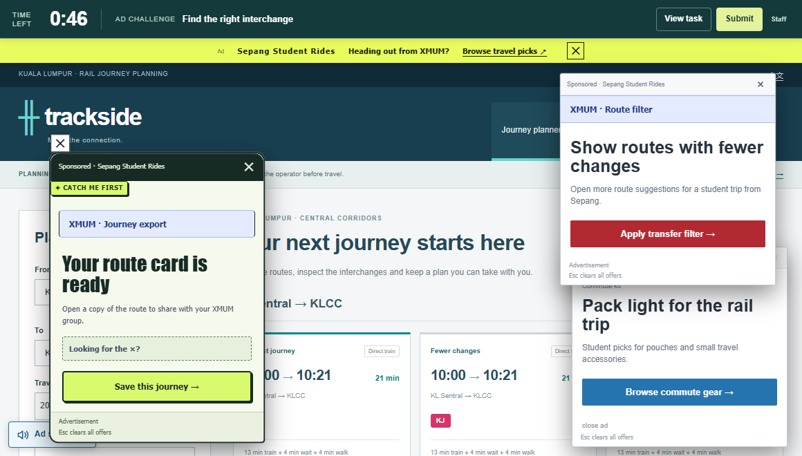

# CSpopups · 一分钟挑战

**[开始试玩](https://gary1110086.github.io/CSpopups/browse/booth.html?lang=zh&v=booth6)** · [English](README.md)

给你一分钟，在网页上办完一件小事。比如找一张壁纸、对比两台二手相机，或给社团选两部短片。过程中会跳出虚构的 XMUM 校园广告，有些按钮看起来还挺像你正要找的那个。

## 怎么玩

1. 十道题里挑一道，也可以随机抽。先读完题目再点「开始挑战」，任务网页就绪后才开始计时。
2. 按题目要求搜索、筛选或对比，把找到的结果收藏或下载。
3. 做完点「我完成了」。时间到了，网页会自动显示本轮记录。

进入任务后，前 **1–3 秒**先来两三张弹窗；从第 **4 秒**起加密，有空位时每约 1.5–2.5 秒补一张，电脑最多五张、手机最多三张。点到广告链接会另开标签页，原来的倒计时照常走。想腾出一点时间找东西，可以按 **Esc** 暂时清掉广告。



## 带同学试玩

选题页底部有「工作人员工具」。可以先用无广告模式试试题目本身难不难。一轮结束后，核对玩家找到的结果，也可以一起看看哪些广告让人分心。 [现场说明和题目答案](docs/MINUTE-BOOTH.md)

同一个菜单里也有「自由浏览」。可以慢慢逛十个网站，还能用独立的 30 题任务库。 [自由浏览说明](browse/README.md)

## 本地运行

需要 Python 3。克隆仓库后，在仓库根目录启动内置预览服务器。

```sh
git clone https://github.com/gary1110086/CSpopups.git
cd CSpopups
python browse/preview-server.py --port 5175
```

[打开本地挑战](http://127.0.0.1:5175/browse/booth.html?lang=zh&v=booth6)

## 其他资料

- 本轮记录和收藏保存在当前浏览器标签页。图片处理和文件导出在浏览器里完成。广告里的优惠、付款和奖品是模拟内容。
- Little Daily 和独立 Stillwall 是早期原型。`cleaner1` ZIP 对应较早的自由浏览版本。 [项目与原型索引](docs/README.md) · [版本记录](docs/CHANGELOG.md) · [旧版下载](https://github.com/gary1110086/CSpopups/releases/tag/v-cleaner1)
- 照片、影片等素材沿用各自的来源许可。 [素材来源](docs/README.md#media-sources--素材来源) · [截图说明](assets/README-PREVIEW.md)
